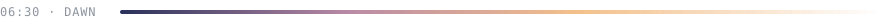
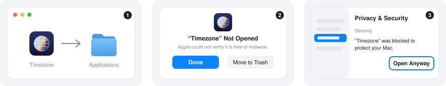
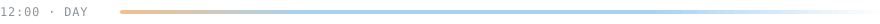
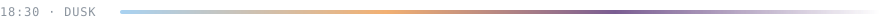
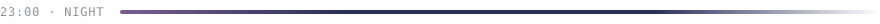

<a href="https://github.com/vyavahareyash/Timezone/releases/latest/download/Timezone.dmg"></a>

A menu bar app for picking meeting times across time zones. Each city is a strip coloured like its sky; drag the bead or type a time into any city, and every other city shows the same moment.

Free and open source · macOS 26 or later · Apple Silicon and Intel · lives in the menu bar, no Dock icon



## Install

Timezone is free, so it isn't notarized by Apple, and macOS asks you to confirm it once. After that it opens like any other app.



1. Open `Timezone.dmg` and drag Timezone to Applications.
2. Open Timezone. macOS stops it the first time: click **Done**.
3. Open **System Settings › Privacy & Security**, scroll to Security and click **Open Anyway**.

The globe appears in your menu bar. Or install with Homebrew, which skips the confirmation:

```sh
brew install --cask vyavahareyash/tap/timezone
```



## Use

| Do this | To |
|---|---|
| Click the globe in the menu bar | Open the panel. Click outside it to close. |
| Drag the white bead, or click a strip | Scrub through today, in 15-minute steps |
| Click a city's time, type `14:30` or `2:30 pm`, press Return | Move every city to that moment, to the minute |
| Click the bead, then <kbd>←</kbd> <kbd>→</kbd> | Step 15 minutes |
| Click **Back to Now** | Return to the present |
| Click **+** and type a city | Add a city. Search works offline and ignores accents. |
| Right-click a row | Rename or remove it. Home can be renamed too. |
| Drag a row | Reorder the list. Home stays first. |
| **⋯ › Launch at login** | Start Timezone when you log in |
| **⋯ › Quit** | Quit. Open Timezone from Spotlight or Applications to bring it back. |

**Reading the panel.** Each strip is that city's day, midnight to midnight in your Home zone, coloured like its sky: night, dawn, day, dusk. One vertical line is the same moment in every row. The red line is Now. **+1** or **−1** next to a time means that city is already on another date, and the abbreviation (CET or CEST) shows whether daylight saving time is on.

**Home** is your Mac's current time zone and follows you when you travel. A name you give Home belongs to that time zone, so it comes back when you return. You can add the same time zone twice under different names, for example "Client" and "Sales". Your cities are saved automatically.



## Limits

- The panel shows today only, so a daylight-saving change appears on the day it happens.
- Dawn and dusk use the same hours for every city, not each city's real sunrise.
- Times follow your Mac's 12- or 24-hour setting.



## Development

Build from source with Xcode and `brew install xcodegen`, then run `scripts/dev run`. [AGENTS.md](AGENTS.md) has the build and test setup, [GLOSSARY.md](GLOSSARY.md) the vocabulary and [docs/adr/](docs/adr/) the decisions.

- `scripts/dev dmg` builds `build/Timezone.dmg` (needs `brew install create-dmg`).
- `python3 scripts/hero.py` redraws the animation at the top of this page.
- Pushing a tag such as `v1.0.0` publishes a release with the DMG and updates the Homebrew cask.

City search uses data from [GeoNames](https://www.geonames.org/) (CC BY 4.0). Timezone is released under the [MIT License](LICENSE).

If Timezone saves you a round of "what time is that for you?", you can buy me a coffee.

<a href="https://buymeacoffee.com/vyavahareyash"></a>

<sub>In 1883 the railways gave the world standard time, and towns lived through noon twice. Timezone keeps it in your menu bar.</sub>
